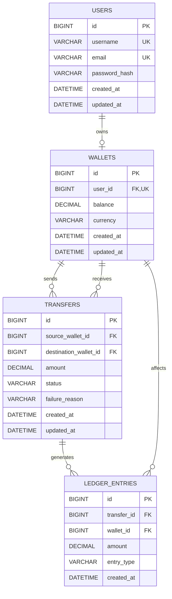

# PayFlow — ERD

This document describes the initial database design for PayFlow.

## Relationship notes

- A user can have zero or one wallet; every wallet belongs to one user.
- A wallet can be the source of many transfers and the destination of many transfers.
- A transfer can have ledger entries. In the current design, a successful transfer should create one `DEBIT` and one `CREDIT` entry; a failed transfer should create no financial entries.
- Each ledger entry belongs to one transfer and affects one wallet.

## Design rules currently represented in the schema

- `users.username` and `users.email` are unique.
- `wallets.user_id` is unique, enforcing at most one wallet per user.
- Wallet balances cannot be negative.
- Supported currencies in this MVP are `EGP`, `USD`, and `EUR`.
- Transfer amounts and ledger-entry amounts must be positive.
- Transfer statuses are `PENDING`, `COMPLETED`, and `FAILED`.
- Ledger entry types are `DEBIT` and `CREDIT`.
- `UNIQUE (transfer_id, entry_type)` prevents more than one entry of the same type for a transfer.

## Important limitations

- The unique constraint does not guarantee that every successful transfer has both a `DEBIT` and a `CREDIT`; application logic and transaction tests must enforce that.
- The schema does not itself enforce that source and destination wallets use the same currency.
- Timestamps are `NOT NULL`; the Java application must populate them before inserts and update `updated_at` when applicable.
- The current model does not include fee entries or reversal relationships yet.
